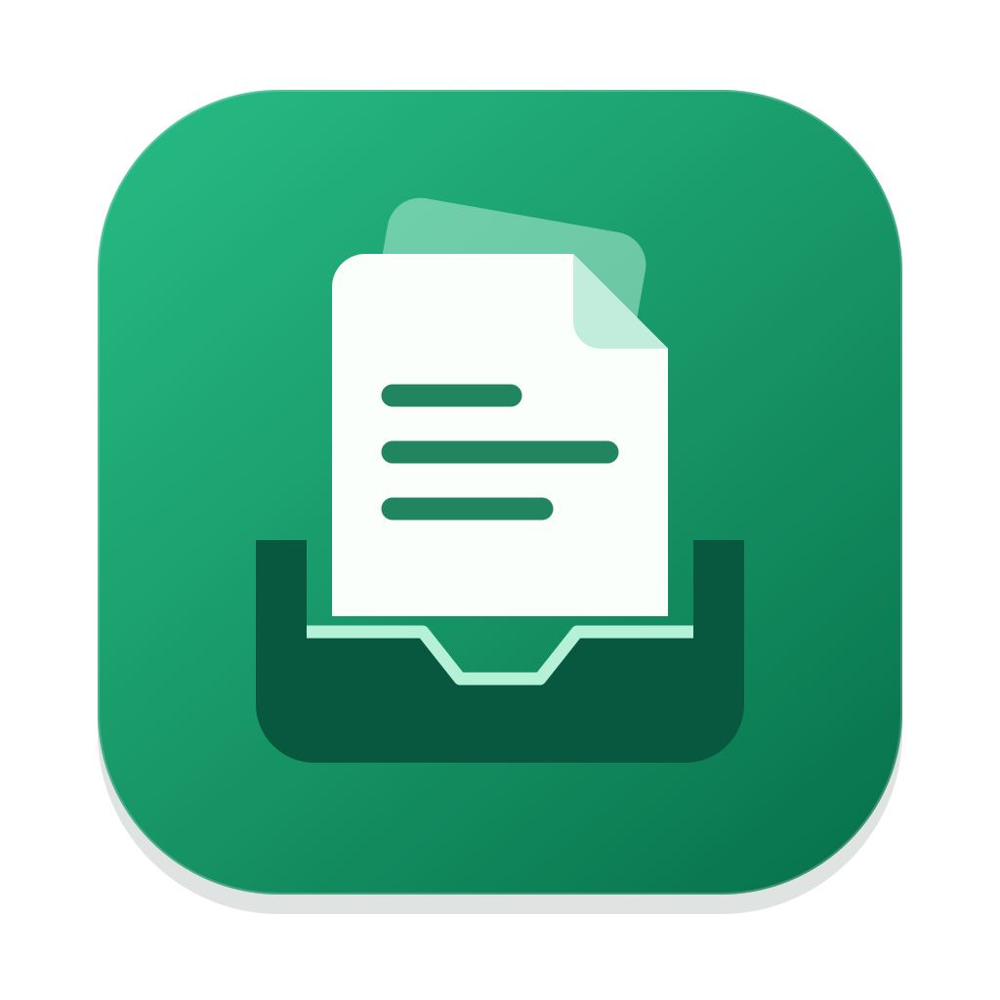
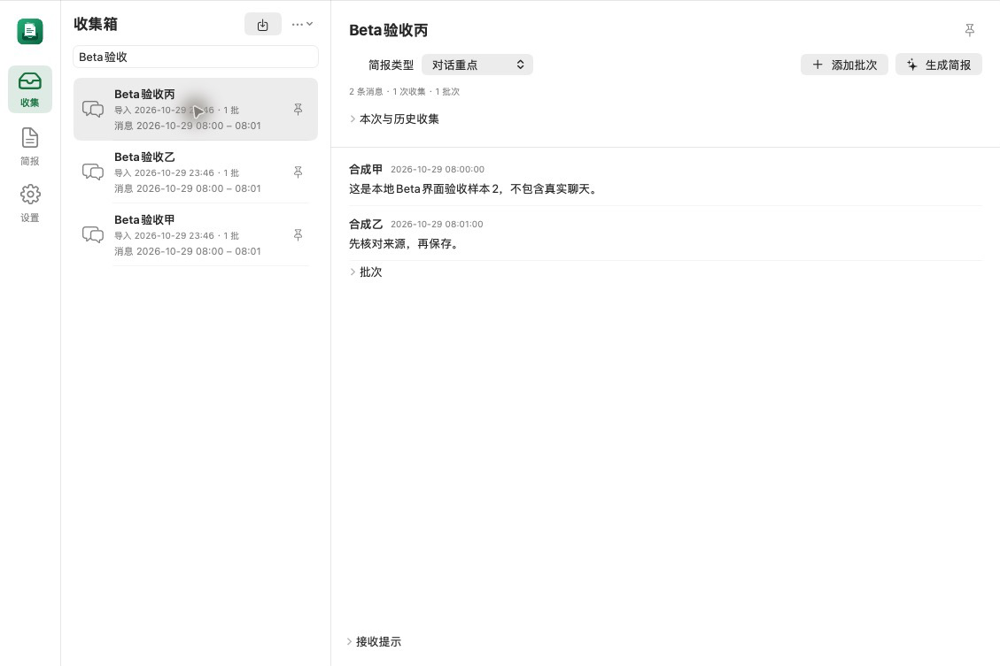

  

<h1 align="center">WeChatPort</h1>

分批收集聊天，让重点、分歧和行动项清楚可见。

<a href="https://github.com/rouicezar/wechatport/releases/tag/v1.0.0-beta.1">下载 Beta 1.0</a> · <a href="LICENSE">个人非商业许可</a>

本地优先的聊天简报 Mac 应用。由你手动分享或导入聊天文件，按会话收集批次，使用自行配置的模型生成简报，并保存为 Markdown。

## 界面预览

应用实际界面，使用合成演示数据；不包含真实聊天或个人信息。

## 使用方式

1. 将 WeChatPort.app 安装到 Applications，打开后选择工作空间。
2. 用户手动在微信中通过“其他应用 → 选择电脑中的应用”分享，或在应用中导入 ZIP/TXT。
3. 确认会话名称和简报类型；连续收集时可添加下一批次，最后完成。
4. 配置 DeepSeek API Key；在应用中确认发送范围后生成，预览并保存 Markdown。

不会读取微信进程或数据库，不自动操作微信。原始文件保留在本机，Key存入系统钥匙串；只有用户确认生成时，所选文本才发送至所选模型服务。

## 下载与兼容

[GitHub Releases](https://github.com/rouicezar/wechatport/releases) 提供已上传的版本。Beta 1.0 为测试版，macOS目标14及以上；Universal包包含Apple Silicon和Intel架构，Intel及最低系统尚未实机验证。Windows版本待提供。

当前包使用Apple Development开发签名，尚未Developer ID签名和公证，不保证其他Mac可直接打开；请勿关闭系统保护。

## 使用许可

仅限个人非商业使用，未经书面许可不得商用或再分发。详见 [LICENSE](LICENSE)。第三方组件和系统资源遵循各自许可。
